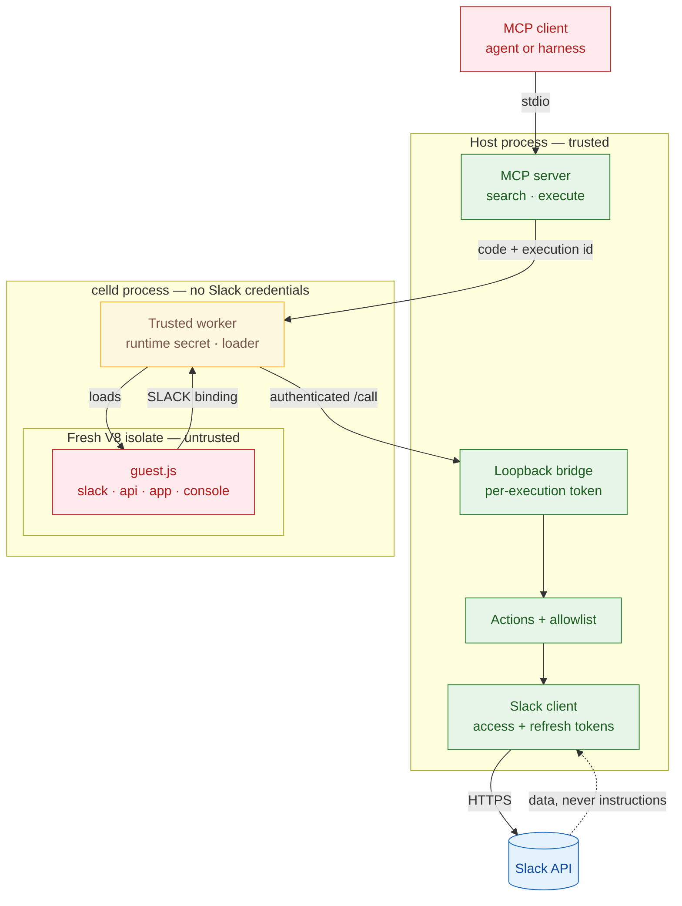

# Slack Code Mode MCP

A Code Mode MCP server for Slack. It gives the model two tools, `search` and `execute`, and runs agent-written JavaScript against the Slack Web API in a sandbox.

The sandbox has no network access and no Slack token.

## Why Code Mode

`search` returns TypeScript signatures from the Slack SDK, so the agent calls methods with the right arguments instead of guessing.

`execute` can chain several calls in one go. For example: find a user, read a thread, reply, and update a canvas. The intermediate results never go back through the model, which keeps the conversation small.

The guest isolate never sees the Slack token. Calls go through a service binding to the host, which holds the credential and enforces the allowlist. The isolate has no outbound access, so `fetch()` throws.

## Requirements

- Node.js 20.12 or newer
- [celld](https://github.com/denoland/celld) v0.6.2 on `PATH` (macOS arm64 and Linux; Windows is not supported)
- A Slack internal app with PKCE enabled

## Install

```bash
git clone https://github.com/mhmdsami/slack-codemode-mcp.git
cd slack-codemode-mcp
npm ci
```

celld is a separate binary. Put it on `PATH`, or point the server at it:

```bash
celld --version
```

```bash
export SLACK_CODEMODE_CELLD_BIN="$HOME/.local/bin/celld"
```

## Configure the Slack app

1. Create an internal app at <https://api.slack.com/apps>.
2. Open **OAuth & Permissions** and enable **PKCE**.
3. Add the redirect URL `http://localhost:33417/callback`.
4. Add the user token scopes the server expects.

```bash
npm run scopes
```

Use a user token, not a bot token. A user token posts as you and sees your channels. A bot token only sees channels the bot joined.

PKCE is one-way. It makes the app a public client, so no client secret is distributed. Colleagues only need the same Client ID.

## Add the Client ID

```bash
cp .env.example .env
$EDITOR .env
```

`.env` holds one value:

```bash
SLACK_CLIENT_ID=...
```

The file is gitignored.

## Authenticate

```bash
npm run auth
```

This opens Slack, completes the PKCE exchange, and stores the token bundle in `~/.config/slack-codemode/token` with mode 0600. Rotating tokens refresh automatically.

Check the token and scopes:

```bash
npm run doctor
```

The checker calls one method per area and reports any missing scope.

## Register the server

Pick your harness.

### Claude Code

```bash
claude mcp add --scope user slack-codemode-mcp -- node "$PWD/mcp/server.mjs"
```

`--scope user` makes the server global. Without it, the entry is tied to the current directory.

### Codex

```bash
codex mcp add slack-codemode-mcp -- node "$PWD/mcp/server.mjs"
```

### OpenCode

```bash
opencode mcp add slack-codemode-mcp --global -- node "$PWD/mcp/server.mjs"
```

### Amp

```bash
amp mcp add slack-codemode-mcp -- node "$PWD/mcp/server.mjs"
```

### Pi

```bash
pi mcp add slack-codemode-mcp -- node "$PWD/mcp/server.mjs"
```

### Antigravity

```bash
agy mcp add slack-codemode-mcp node "$PWD/mcp/server.mjs"
```

### Zed

Add this to `~/.config/zed/settings.json`:

```jsonc
"context_servers": {
  "slack-codemode-mcp": {
    "command": "node",
    "args": ["/absolute/path/to/slack-codemode-mcp/mcp/server.mjs"]
  }
}
```

If a harness starts with a narrow `PATH`, set `SLACK_CODEMODE_CELLD_BIN` to the celld binary.

## Try it

Ask the agent to run this through the MCP:

```js
return await app.whoami();
```

## Tools

| Tool | Purpose |
|---|---|
| `search` | Find an allowed method by name, or fetch a TypeScript type. |
| `execute` | Run JavaScript with `app.*`, `slack.*`, `api.call`, and `console`. |

`search` covers allowlisted methods by default. It also lists methods that are missing from the bundled SDK index. To search the full API, pass `include_blocked: true`. Type declarations are omitted unless `include_types: true`.

## Actions

`app.*` is the recommended surface. It covers lookups, DMs, posts, message edits and search, threads, message links, file uploads, and canvases.

Thread reads return a condensed transcript by default, so reading and summarizing does not carry raw message objects through the model. Pass `{ format: "json" }` when you need fields.

Actions paginate and cache in the host, not in the guest. Raw allowlisted methods stay available through `slack.*` and `api.call`.

```js
return await app.search("deploy failed", { count: 10 });
```

```js
await app.edit("#oncall", "1699999999.000000", "fixed the typo");
```

```js
const { canvas_id } = await app.canvas.create("Oncall 42", "# Week 42");
await app.canvas.share(canvas_id, { channel_ids: ["C123ABC"] });
```

See [docs/actions.md](docs/actions.md) for the full surface and examples.

## Security model



The host holds the token and the allowlist. celld holds no Slack credentials. The isolate has no network, no filesystem, and no token.

Each execution gets a random id and a bridge token. The bridge removes the record when the execution ends, so a late or forged call cannot reuse it.

For the full threat model, see [docs/security.md](docs/security.md). For the request flow, see [docs/architecture.md](docs/architecture.md).

## Development

```bash
npm run gate
npm run test
npm run format
npm run doctor
npm run generate
```

`gate` runs Biome and the unit tests. CI runs the same command.

Lefthook runs Biome and the tests on commit, and the full gate on push:

```bash
npm install
npx lefthook install
```

CI runs the gate on Ubuntu and macOS. See [.github/workflows/ci.yml](.github/workflows/ci.yml).

## Docs

- [Agent setup](docs/agent-setup.md)
- [Architecture](docs/architecture.md)
- [Authentication](docs/authentication.md)
- [Actions](docs/actions.md)
- [Security](docs/security.md)
- [Development](docs/development.md)
- [Troubleshooting](docs/troubleshooting.md)

Licensed under the [MIT License](LICENSE).
