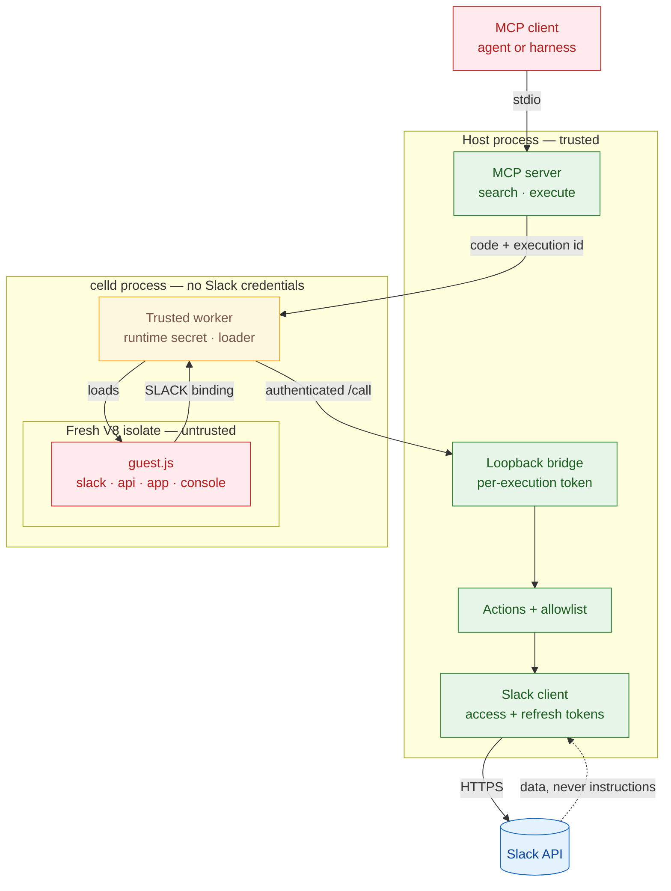

# Slack Code Mode MCP

A Code Mode MCP server for Slack. It exposes two tools, `search` and `execute`, and runs agent-written JavaScript against the Slack Web API in a celld V8 isolate with no network access and no Slack token.

## Why Code Mode

`search` returns TypeScript signatures from the Slack SDK, so the agent calls methods with the right arguments instead of guessing them. One execution can chain several calls, such as resolving a user, reading a thread, posting a reply, and editing a canvas, without sending intermediate results back through the model.

The guest isolate never receives the Slack token. Calls go through a service binding to the host, which holds the credential and enforces the allowlist. The isolate has `globalOutbound: null`, so `fetch()` throws.

## Requirements

- Node.js 20+
- [celld](https://github.com/denoland/celld) v0.6.2 on `PATH` (macOS arm64 and Linux; Windows is not supported)
- A Slack internal app with PKCE enabled

## Install

```bash
git clone https://github.com/mhmdsami/slack-codemode-mcp.git
cd slack-codemode-mcp
npm ci
```

Celld is a separate binary. Put it on `PATH`, or point the server at it with `SLACK_CODEMODE_CELLD_BIN`.

```bash
celld --version
```

## Configure the Slack app

1. Create an internal app at <https://api.slack.com/apps>.
2. Open **OAuth & Permissions** and enable **PKCE**. This is one-way and makes the app a public client, so no client secret is distributed.
3. Add the redirect URL `http://localhost:33417/callback`.
4. Add the user token scopes the server expects:

```bash
npm run scopes
```

A user token attributes messages to you and keeps canvases on your account. A bot token would post as an app and only see channels the bot joined. Because the app is a public client, colleagues need only the same Client ID.

## Add the Client ID

```bash
cp .env.example .env
$EDITOR .env
```

`.env` holds one value, `SLACK_CLIENT_ID`. It is gitignored.

## Authenticate

```bash
npm run auth
```

This opens Slack, completes the PKCE exchange, and stores the token bundle in the macOS Keychain or `~/.config/slack-codemode/token` on Linux. Rotating tokens refresh automatically.

```bash
npm run doctor
```

The checker calls one method per area and reports any missing scope.

## Register the server

Pick your harness.

### Claude Code

Claude Code needs `--scope user` to make the server global. Without it, the entry is tied to the current directory.

```bash
claude mcp add --scope user slack-codemode-mcp -- node "$PWD/mcp/server.mjs"
```

### Codex

```bash
codex mcp add slack-codemode-mcp -- node "$PWD/mcp/server.mjs"
```

### OpenCode

```bash
opencode mcp add slack-codemode-mcp --global -- node "$PWD/mcp/server.mjs"
```

### Amp

```bash
amp mcp add slack-codemode-mcp -- node "$PWD/mcp/server.mjs"
```

### Pi

```bash
pi mcp add slack-codemode-mcp -- node "$PWD/mcp/server.mjs"
```

### Antigravity

```bash
agy mcp add slack-codemode-mcp node "$PWD/mcp/server.mjs"
```

### Zed

Add this to `~/.config/zed/settings.json`:

```jsonc
"context_servers": {
  "slack-codemode-mcp": {
    "command": "node",
    "args": ["/absolute/path/to/slack-codemode-mcp/mcp/server.mjs"]
  }
}
```

If a harness starts with a narrow `PATH`, set `SLACK_CODEMODE_CELLD_BIN` to the celld binary.

## Try it

Ask the agent to run this through the MCP:

```js
return await app.whoami();
```

## Tools

| Tool | Purpose |
|---|---|
| `search` | Find an allowed method by name, or fetch a TypeScript type. |
| `execute` | Run JavaScript with `app.*`, `slack.*`, `api.call`, and `console`. |

`search` covers allowlisted methods by default. Pass `include_blocked: true` to search the full index.

## Actions

`app.*` covers lookups, DMs, posts, threads, message links, file uploads, and canvases. Actions paginate and cache in the host, not in the guest. Raw allowlisted methods remain available through `slack.*` and `api.call`.

See [docs/actions.md](docs/actions.md) for the full surface and examples.

## Security model



The host holds the token and the allowlist. celld holds no Slack credentials. The isolate has no network, no filesystem, and no token. Each execution gets a random id and bridge token. See [docs/security.md](docs/security.md) for the threat model and [docs/architecture.md](docs/architecture.md) for the request flow.

## Development

```bash
npm run gate
npm run test
npm run format
npm run doctor
npm run generate
```

`gate` runs Biome and the unit tests, and is what CI runs. Lefthook runs Biome and tests on commit and the full gate on push:

```bash
npm install
npx lefthook install
```

CI runs the gate on Ubuntu and macOS (`.github/workflows/ci.yml`).

## Docs

- [Agent setup](docs/agent-setup.md)
- [Architecture](docs/architecture.md)
- [Authentication](docs/authentication.md)
- [Actions](docs/actions.md)
- [Security](docs/security.md)
- [Development](docs/development.md)
- [Troubleshooting](docs/troubleshooting.md)

Licensed under the [MIT License](LICENSE).
