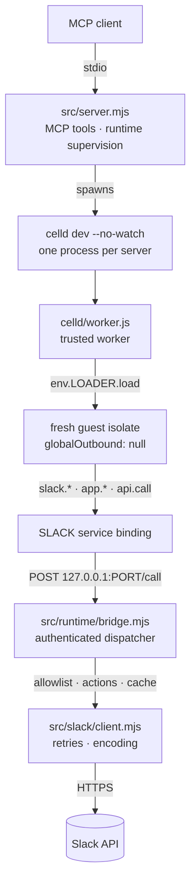
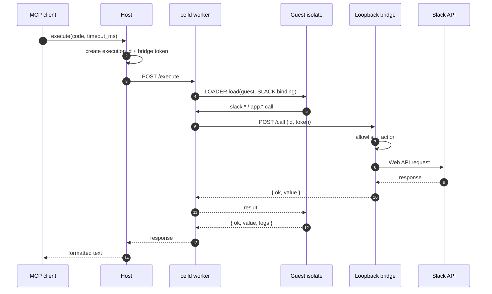

# Architecture

## Request flow



## Modules

| Path | Responsibility |
|---|---|
| `mcp/server.mjs` | Entry point. Imports and runs `src/server.mjs`. |
| `src/server.mjs` | MCP tool registration, runtime lifecycle, result formatting. |
| `src/config.mjs` | Paths, limits, version, index and allowlist readers. |
| `src/credentials.mjs` | Token resolution and storage across platforms. |
| `src/search.mjs` | Method search, allowlist merge, type lookup, rendering. |
| `src/slack/client.mjs` | Slack HTTP, retries, 429 handling, encoding fallback. |
| `src/actions/*` | Multi-call behavior: users, channels, messages, canvas, files. |
| `src/actions/input.mjs` | Shared input validation for ids, timestamps, limits, arrays. |
| `src/runtime/bridge.mjs` | Loopback HTTP dispatcher and execution registry. |
| `src/runtime/celld.mjs` | celld process, health checks, execution, cleanup. |
| `celld/worker.js` | Trusted worker: runtime secret, guest loader, bridge entrypoint. |
| `celld/guest.js` | Guest module: `slack`, `app`, `api`, `console`, result serialization. |
| `scripts/auth.mjs` | PKCE authorization and token storage. |
| `scripts/check.mjs` | Token and scope probe. |
| `scripts/generate-api.mjs` | Builds `api-index.json` from the SDK declarations. |

## Execution lifecycle



The host sends this body:

```json
{
  "code": "return await app.whoami();",
  "executionId": "random-id",
  "bridgeUrl": "http://127.0.0.1:PORT/call",
  "bridgeToken": "random-token",
  "executionMs": 30000,
  "hostCalls": 64
}
```

The worker checks the runtime secret and the request shape. It then loads the isolate with `globalOutbound: null` and limits for CPU time and sub-requests.

The execution record is removed in a `finally`. A late or forged bridge call cannot reuse it.

## Caching

Users, channels, DM channels, and resolved names are cached in the host for ten minutes.

DM and name entries expire on read, and the maps are bounded. A long session does not accumulate stale entries.

The guest never holds a directory.

Directory scans are capped:

- `users.list`: two pages
- `conversations.list`: ten pages

Results carry `complete: false` when the cap was reached, so a miss is not reported as final.

User lookup prefers `assistant.search.context`. That is one call and avoids the rate-limit cliff.

## Failure handling

A 429 honors `Retry-After` and retries up to three times. Then it returns a typed `ratelimited` error.

A 5xx or network error gets exponential backoff with jitter, but only for reads.

`invalid_arguments` or `missing_charset` retries the call with form encoding.

Writes are never retried. Slack may have applied the write, so the result is `ambiguous_result` with a `client_msg_id` where possible.

A celld crash is detected through the child exit. The next execution starts a new runtime, and the failure message includes the tail of celld's stderr.

An oversized bridge body returns `request_too_large` at 64 KiB. Oversized results are truncated by byte length, not character count.

Token expiry is handled with the stored refresh token, coordinated by a lock file. A re-auth takes effect without restarting the server.
