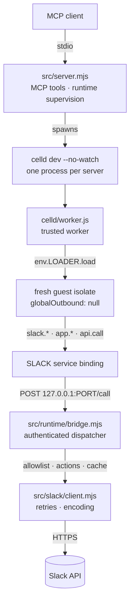
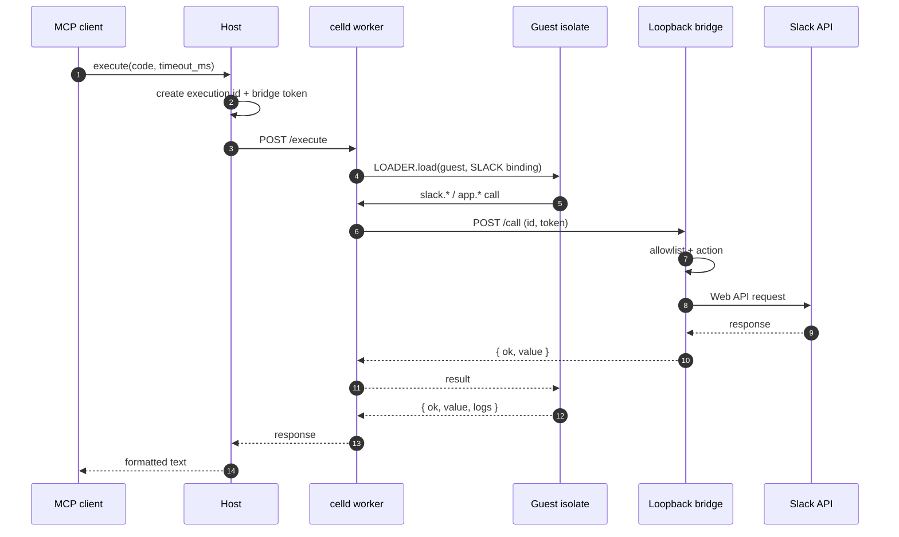

# Architecture

## Modules

| Path | Responsibility |
|---|---|
| `mcp/server.mjs` | Entry point. Imports and runs `src/server.mjs`. |
| `src/server.mjs` | MCP tool registration, runtime lifecycle, result formatting. |
| `src/config.mjs` | Paths, limits, index and allowlist readers. |
| `src/credentials.mjs` | Token resolution and storage across platforms. |
| `src/search.mjs` | Method search, type lookup, rendering. |
| `src/slack/client.mjs` | Slack HTTP, retries, 429 handling, encoding fallback. |
| `src/actions/*` | Multi-call behavior: users, channels, messages, canvas, files. |
| `src/runtime/bridge.mjs` | Loopback HTTP dispatcher and execution registry. |
| `src/runtime/celld.mjs` | celld process, health checks, execution, cleanup. |
| `celld/worker.js` | Trusted worker: runtime secret, guest loader, bridge entrypoint. |
| `celld/guest.js` | Guest module: `slack`, `app`, `api`, `console`, result serialization. |
| `scripts/auth.mjs` | PKCE authorization and token storage. |
| `scripts/check.mjs` | Token and scope probe. |
| `scripts/generate-api.mjs` | Builds `api-index.json` from the SDK's declarations. |

## Execution lifecycle

The host posts `{ code, executionId, bridgeUrl, bridgeToken, executionMs, hostCalls }`. The worker validates the runtime secret and request shape, then loads the isolate with `globalOutbound: null` and `limits: { cpuMs, subRequests }`. The execution record is removed in a `finally`, so a late or forged bridge request cannot reuse it.

## Caching

Users, channels, DM channels, and resolved names are cached in the host for ten minutes. The guest never holds a directory.

Directory scans are capped: `users.list` at two pages and `conversations.list` at ten. User lookup prefers `assistant.search.context`, which is one call and avoids the rate-limit cliff.

## Failure handling

- 429: honor `Retry-After`, up to three retries, then a typed `ratelimited` error.
- 5xx and network errors: exponential backoff with jitter.
- `invalid_arguments` or `missing_charset`: retry form-encoded.
- celld crash: detected via child exit; the next execution starts a new runtime.
- Token expiry: refreshed with the stored refresh token, coordinated by a lock file. A re-auth takes effect without restarting the MCP server.
