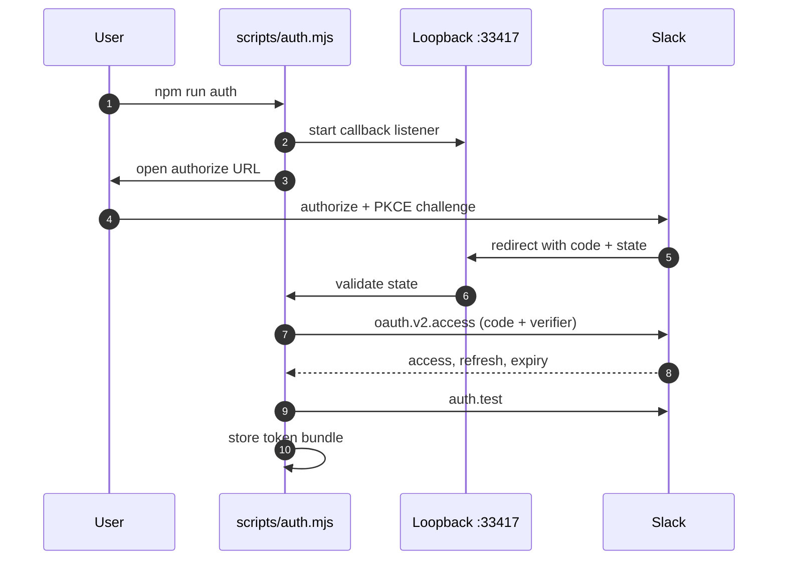
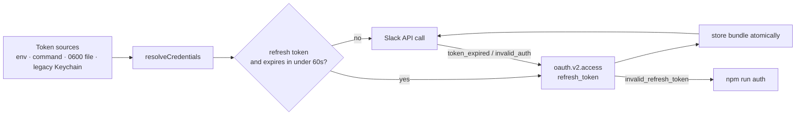

# Authentication

Slack issues user tokens through OAuth. This server uses **PKCE**, which makes the app a public client and removes the client secret.

## Slack app

1. Create an internal app at <https://api.slack.com/apps>.
2. Open **OAuth & Permissions** and enable **PKCE**. This cannot be undone.
3. Add the redirect URL `http://localhost:33417/callback`.
4. Add the user token scopes listed below.

## Scopes

The authoritative list is printed by:

```bash
npm run scopes
```

```text
chat:write
channels:read        channels:history
groups:read          groups:history
im:read              im:write             im:history
mpim:read            mpim:write           mpim:history
search:read          search:read.users
users:read           users:read.email
usergroups:read
files:read           files:write
canvases:read        canvases:write
```

| Method | Scope |
|---|---|
| `chat.postMessage`, `chat.update` | `chat:write` |
| `chat.getPermalink` | none |
| `conversations.list`, `conversations.info` | `channels:read`, `groups:read`, `im:read`, `mpim:read` |
| `conversations.history`, `conversations.replies` | `channels:history`, `groups:history`, `im:history`, `mpim:history` |
| `conversations.open` | `im:write`, `mpim:write` |
| `search.messages` | `search:read` |
| `assistant.search.context` | `search:read.users` |
| `users.info`, `users.list`, `auth.test` | `users:read` |
| `users.lookupByEmail` | `users:read.email` |
| `usergroups.list` | `usergroups:read` |
| `files.info` | `files:read` |
| `files.getUploadURLExternal`, `files.completeUploadExternal` | `files:write` |
| `canvases.create`, `canvases.edit`, `canvases.access.set` | `canvases:write` |
| `canvases.getContent`, `canvases.sections.lookup` | `canvases:read` |

## Run the flow

```bash
SLACK_CLIENT_ID=... npm run auth
```



Useful flags:

```bash
npm run auth -- --dry-run   # print the URL and exit
npm run auth -- --no-open   # print the URL, do not open a browser
```

To use a different callback port:

```bash
SLACK_OAUTH_PORT=34567 npm run auth
```

## Token storage

The token is resolved in this order:

1. `SLACK_USER_TOKEN`
2. `SLACK_TOKEN_CMD`, which prints the token
3. `~/.config/slack-codemode/token`, mode 0600
4. macOS Keychain, for a legacy raw token only

A successful login writes a bundle to:

```text
~/.config/slack-codemode/token
```

The file is written atomically with mode 0600.

To store the bundle somewhere else, set a command that reads it from stdin:

```bash
export SLACK_TOKEN_STORE_CMD="op item edit slack-codemode token=\$(cat)"
```

macOS Keychain is only read for a legacy raw token. Its command-line interface truncates stdin at 128 bytes, which is too small for an access token plus a refresh token.

## Verify

```bash
npm run doctor
```

The checker probes one method per area with fixture ids.

`channel_not_found`, `user_not_found`, and `canvas_not_found` count as passes. The scope worked and the fixture simply does not exist.

## Colleagues

Everyone runs the server on their own machine with their own user token.

With PKCE they only need the Client ID:

```bash
SLACK_CLIENT_ID=...
```

Then run the same three steps:

```bash
npm run auth
npm run doctor
```

Nothing sensitive is shared between machines.

## Token rotation



With rotation enabled, Slack returns an access token, a refresh token, and an expiry. The server stores all three plus the Client ID.

Before a call, if the access token expires within 60 seconds, the server refreshes it. If Slack answers `token_expired` or `invalid_auth`, it refreshes once and retries.

A refresh times out after 20 seconds. The lock holder re-reads the stored bundle before rotating.

A lock file coordinates refreshes across processes:

```text
~/.config/slack-codemode/refresh.lock
```

Two MCP servers cannot rotate the same refresh token at once. The process that loses the race reuses the token the winner stored.

Refresh tokens expire after 30 days with PKCE. When a refresh fails with `invalid_refresh_token`, log in again:

```bash
npm run auth
```

`SLACK_USER_TOKEN` and `SLACK_TOKEN_CMD` supply a token without a refresh token. They cannot renew, so log in again when they expire.
