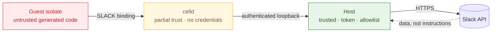

# Security

## Assets

- The Slack user token, which can act as the user in every conversation they belong to.
- Slack content read through the tools.
- Local files passed to `app.sendFile`.
- The machine running celld.

## Trust boundaries

| Boundary | Trusted | Untrusted |
|---|---|---|
| Host process | yes | — |
| celld process | partially, no credentials | — |
| Guest isolate | no | everything it runs |
| Slack responses | data, not instructions | message text |

The host is the only component with the token, the allowlist, and access to Slack. The guest is treated as generated code.

## Threats and mitigations

### Token exfiltration from the guest

The guest has no token in its environment, no `process`, no imports, and no filesystem. Slack calls go through a service binding to the trusted worker, which forwards to a host dispatcher that adds the token. `process.env` in the isolate is empty.

### Network egress

`globalOutbound: null` makes `fetch()` and `connect()` throw. The dynamic worker receives only the `SLACK` binding.

### Bridge forgery

Each execution has a random id and a 32-byte bridge token. The host checks both, removes the record in `finally`, and rejects unknown or stale ids. The trusted worker also validates a runtime secret against a SHA-256 hash before loading a guest.

### Prompt injection

Slack content can contain instructions. The allowlist limits the blast radius: no deletes, archives, invites, kicks, or admin methods. The model is instructed to treat message content as data, and all write actions are explicit calls the user asked for.

### Destructive actions

Destructive methods are not on the allowlist, so they cannot be reached even by raw `slack.*` calls. The list is enforced in the host, not in the guest.

### Large payloads

Directory scans are capped and cached. Responses are bounded by the isolate budget and host call limit.

### Local file access

`app.sendFile` reads a path in the host. Path uploads are disabled unless `SLACK_CODEMODE_UPLOAD_ROOTS` lists allowed directories. Paths are resolved with `realpath`, checked against those roots, and read through one `O_NOFOLLOW` descriptor. The credential directory, common secret directories, and system paths are rejected. A broad root weakens this boundary.

### Denial of service

Execution has a wall deadline and a CPU budget. celld enforces `cpuMs`, and the host aborts the HTTP request at the deadline. A hanging await is cancelled through the request signal, and host Slack calls and uploads stop when that signal aborts.

## Credentials

- Token: `SLACK_USER_TOKEN`, `SLACK_TOKEN_CMD`, or a 0600 file. Token bundles are written atomically and never passed through command-line arguments. macOS Keychain is read only for a legacy raw token.
- App client id: `.env`, public by design.
- No client secret exists in the PKCE flow.
- celld's environment contains no Slack credentials.

## Reporting

Open an issue without secrets, tokens, workspace names, or message content. For sensitive reports, contact the maintainer directly.
