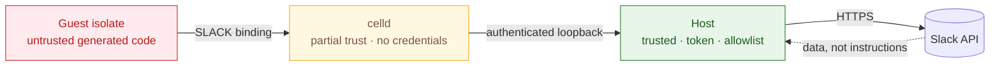

# Security

## What we protect

- The Slack user token. It can act as you in every conversation you belong to.
- Slack content read through the tools.
- Local files passed to `app.sendFile`.
- The machine that runs celld.

## Trust boundaries



| Boundary | Trusted | Untrusted |
|---|---|---|
| Host process | Yes | Nothing |
| celld process | Partially, no credentials | Nothing |
| Guest isolate | No | Everything it runs |
| Slack responses | No | Treat as data, never instructions |

The host is the only part with the token, the allowlist, and Slack access. The guest is treated as generated code.

## Threats and mitigations

### Token theft from the guest

The guest has no token, no `process`, no imports, and no filesystem. `process.env` is empty.

Slack calls go through a service binding to the trusted worker, then to a host dispatcher. The host adds the token.

### Network egress

The guest runs with `globalOutbound: null`, so `fetch()` and `connect()` throw.

The dynamic worker receives only the `SLACK` binding.

### Bridge forgery

Each execution gets a random id and a 32-byte bridge token.

The host checks both with a timing-safe comparison and removes the record in `finally`. Unknown or stale ids get a 401.

The bridge also rejects browser-origin requests and returns a typed `request_too_large` instead of dropping the connection.

The trusted worker validates a runtime secret against a SHA-256 hash before loading a guest.

### Prompt injection

Slack content can contain instructions. The allowlist limits the blast radius: no deletes, archives, invites, kicks, or admin methods.

The model is told to treat message content as data. Write actions are explicit calls the user asked for.

Tool annotations mark `search` as read-only and `execute` as potentially writing, so harnesses can gate writes.

### Destructive actions

Destructive methods are not on the allowlist. They cannot be reached, even with a raw `slack.*` call.

The list is enforced in the host, not in the guest.

### Large payloads

Directory scans are capped and cached. Results are capped by byte length.

Each bridge call is capped at 64 KiB. Each execution has a call limit and a wall deadline.

### Local file access

`app.sendFile` reads a path in the host. Path uploads are disabled unless `SLACK_CODEMODE_UPLOAD_ROOTS` lists allowed directories.

Paths are resolved with `realpath`, checked against those roots, and read through one `O_NOFOLLOW` descriptor.

These paths are always rejected:

```text
~/.config/slack-codemode
~/.ssh  ~/.aws  ~/.gnupg  ~/.kube  ~/.docker  ~/.config/gh
~/Library/Keychains
~/.netrc  ~/.npmrc  ~/.pgpass  ~/.git-credentials
/proc  /sys  /dev  /etc  /System  /bin  /sbin  /usr  /Library
```

The upload URL returned by Slack is checked before any bytes are sent. It must be HTTPS on `slack.com` or `*.slack.com`, so a bad response cannot redirect a file elsewhere.

A broad upload root weakens this boundary. Keep it narrow.

### Denial of service

Execution has a wall deadline and a CPU budget. celld enforces `cpuMs`, and the host aborts the HTTP request at the deadline.

A hanging await is cancelled through the request signal. Slack calls and uploads stop when that signal aborts.

## Credentials

The token comes from one of these sources:

```text
SLACK_USER_TOKEN
SLACK_TOKEN_CMD
~/.config/slack-codemode/token
```

Token bundles are written atomically. They are never passed as command-line arguments.

The config directory is kept at mode 0700 and the token file at 0600. macOS Keychain is read only for a legacy raw token.

The app client id lives in `.env`. It is public by design, and there is no client secret in the PKCE flow.

celld's environment contains no Slack credentials.

The browser is opened with an argument vector, not a shell string, so a crafted URL cannot inject a command.

`SLACK_TOKEN_CMD` and `SLACK_TOKEN_STORE_CMD` are user-supplied shell commands. They are the one intentional shell boundary. Point them at a trusted helper.

## Reporting

Open an issue without secrets, tokens, workspace names, or message content.

For a sensitive report, contact the maintainer directly.
